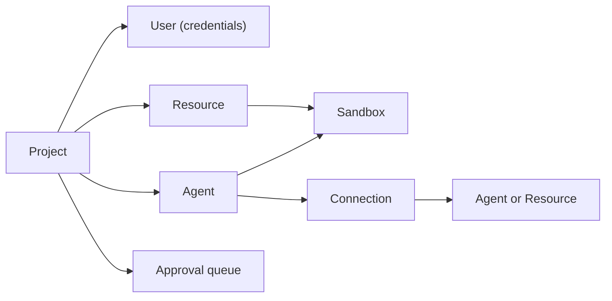

# Mycelium Core Domain

This Component owns Mycelium's domain data structure and trust rules: the
multi-user, project-scoped registry of agents and resources, the sandboxes
that back them, the tailcat connections between them, and the approval queue
that carries every human decision. It is a Postgres-backed Ecto domain
library. Gateway (OpenShell) state is referenced and cached here, never
authoritative; orchestration of gateways, sandboxes, and tailcat lives in
consuming Components.

## Application contract

| Concern | Decision |
| --- | --- |
| Component kind | `library` profile (no product entrypoint) |
| Hex package name | `mycelium_core` |
| Module namespace | `Mycelium.Core` (public modules live inside it) |
| Persistence | Ecto schemas and migrations against PostgreSQL |
| Hex dependencies | `ecto_sql`, `postgrex`, `jason` only |
| Gateway coupling | Sandboxes reference the gateway by name; gateway state is a cached projection, never authority |

The public module surface is defined by `interfaces/mycelium-core.md`; consumers
SHALL depend on that interface rather than any generated file organization.

### Requirement: Users are the trust roots

A User SHALL belong to exactly one Project, carry the user's forge identity
(`forge_login`), and hold zero or more credentials of kind `ssh_key` or
`api_key`. The first user of a project SHALL be self-approved; every later
user SHALL record `approved_by_user_id`. Credentials are stored as
provider material referenceable by sandbox orchestration; the domain SHALL
NOT deliver credentials to agents itself.

#### Scenario: Bootstrap user is self-approved

- **WHEN** the first user is added to an empty project
- **THEN** the user is recorded as approved with `approved_by_user_id` set to
  itself, and a second user added without an approver is rejected

### Requirement: Agents are implicitly trusted on addition

An Agent SHALL belong to exactly one Project and one owning User, carry a
project-unique name, and record the approved user who added it. Addition by
an approved user is itself the trust grant: the agent MAY request resources
and connections on the user's behalf without further user action, and the
domain SHALL NOT require per-action approval for an agent's requests except
where this specification states otherwise.

#### Scenario: Added agent acts on behalf of its owner

- **WHEN** an approved user adds an agent
- **THEN** the agent can immediately request a resource or a connection, and
  the request is evaluated by policy and the connection rules below without
  a mandatory human decision

### Requirement: Connections follow the three approval rules

A Connection SHALL record a source Agent and a destination that is either an
Agent or a Resource, the protocol carried (a2a for agent-to-agent; the
resource's protocol otherwise), and the tailcat custody. Approval SHALL be
decided exactly by the destination kind and ownership:

- Agent to Resource: auto-approved.
- Agent to Agent with the same owner: auto-approved.
- Agent to Agent with a different owner: an Approval row targeting the
  destination agent's owning user; the connection activates only on that
  user's approval.

#### Scenario: Cross-user connection waits for the destination owner

- **WHEN** agent A owned by user 1 requests a connection to agent B owned by
  user 2
- **THEN** a pending Approval is recorded for user 2, the connection stays
  `requested`, and it becomes `active` only after user 2 approves

#### Scenario: Same-owner and resource connections need no human

- **WHEN** agent A requests a connection to a resource, or to another agent
  owned by the same user
- **THEN** the connection is recorded `active` immediately with no Approval row

### Requirement: Resource creation is policy-gated auto

Each Project SHALL carry a policy (JSON) with at least a resource-count
limit and an image allowlist. When an agent requests a new resource, the
domain SHALL evaluate the request against the policy: within limits and
allowlist, the resource and its sandbox record are created immediately
(`created_via: policy_auto`); beyond them, a pending Approval row is
recorded (`add_resource`) and no sandbox is created until a user approves.

#### Scenario: Within-policy request auto-creates

- **WHEN** a project with zero resources and a limit of one receives an
  agent request for an allowlisted image
- **THEN** the resource exists immediately with `created_via: policy_auto`
  and a bound sandbox record

#### Scenario: Beyond-policy request queues for approval

- **WHEN** the resource count is at the policy limit
- **THEN** a pending `add_resource` Approval is recorded, no resource row is
  created, and approving it creates the resource and sandbox

### Requirement: One approval queue carries every human decision

The domain SHALL record every human decision in one Approval table with
`kind` (`add_agent`, `add_resource`, `connect_agents`), the requester (agent
or user), a JSON payload, `status` (`pending`, `approved`, `denied`), the
deciding user, and the decision time. Approving a queued request SHALL
apply its effect exactly once; denying SHALL record the denial without
side effects.

#### Scenario: Approval applies exactly once

- **WHEN** a pending `connect_agents` approval is approved twice
- **THEN** the second decision is rejected and the connection state does not
  change again

### Requirement: Sandboxes are the only runtime binding

Every Agent and Resource SHALL reference at most one Sandbox row, and a
Sandbox row SHALL reference exactly one subject (`agent` or `resource`) by
type and id. The Sandbox row carries the OpenShell gateway sandbox name,
image, and a cached projection of gateway state with its observation time.
Deleting a subject SHALL cascade its sandbox row.

#### Scenario: Sandbox state is a cache

- **WHEN** the cached gateway state of a sandbox is stale or absent
- **THEN** the domain still answers queries from its own rows; consumers
  refresh the cache through the gateway, and no domain decision depends on
  cache freshness

### Requirement: Sandbox rows are created through the context

Consumers SHALL create sandbox rows through `create_sandbox/3`, which SHALL
refuse unknown subjects and a second sandbox row for the same subject, so
the one-runtime-binding invariant is enforced in exactly one place.

#### Scenario: Duplicate sandbox row is refused

- **WHEN** `create_sandbox/3` runs twice for the same subject
- **THEN** the second call is refused with a structured error and the first
  row is unchanged

### Requirement: Gateway bindings and tailcat custody are domain mutations

Consuming orchestration SHALL record a sandbox's gateway binding
(`gateway_sandbox_name`) and a connection's tailcat custody through the
context functions `bind_sandbox_gateway/3` and `set_connection_custody/2`,
not by writing the schema tables directly. Custody is cleared by recording
an empty map.

#### Scenario: Custody round-trips through the context

- **WHEN** `set_connection_custody/2` records a custody map and then an
  empty map
- **THEN** the connection row reflects each write and both calls return
  `{:ok, connection}`
