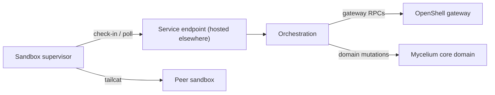

# Mycelium Sandbox Orchestration

This Component binds the core domain's records to real OpenShell sandboxes and
brokers tailcat connections between them. It drives the OpenShell gateway
through the `mycelium.openshell-elixir` client capability, records what it
observes back into the `mycelium.mycelium-core` domain, and owns the
supervisor coordination protocol semantics (check-in and poll). It hosts no
endpoint itself: the Mycelium service component exposes the check-in/poll HTTP
surface and calls into this library.

## Application contract

| Concern | Decision |
| --- | --- |
| Component kind | `library` profile (no product entrypoint) |
| Hex package name | `mycelium_orchestration` |
| Module namespace | `Mycelium.Orchestration` |
| Hex dependencies | none — gateway calls come from the `mycelium.openshell-elixir` capability, domain mutations from `mycelium.mycelium-core` |
| Sandbox images | supplied by the project's allowlisted images, which MUST contain the Mycelium supervisor and tailcat; this Component never builds or uploads images |
| Tailcat custody | one ephemeral `tailcat` listener per connection inside the destination sandbox; addresses are recorded in the connection row and never reused |

## The supervisor coordination protocol

OpenShell sandboxes are default-deny: the only coordination path that needs no
new transport is sandbox-initiated egress to an approved Mycelium endpoint.
Every allowlisted image's supervisor therefore performs two operations against
the service endpoint:

- **check-in** — after starting a tailcat listener, the supervisor posts
  `{"sandbox": <gateway sandbox name>, "role": "serve", "address": <tailcat
  address>}`. Orchestration validates the sandbox and records the address.
- **poll** — the supervisor retrieves `{"assignments": [...]}` where each
  assignment carries `{"role": "dial", "address": <tailcat address>,
  "connection": <id>}`; the supervisor dials the address with tailcat.

Assignment delivery is at-least-once and idempotent by connection id; the
supervisor dials a given connection's address only until the connection
leaves `active`.

### Requirement: Sandbox provisioning binds records to the gateway

`ensure_sandbox/1` SHALL create a gateway sandbox for an agent or resource
whose domain row lacks one, using the image recorded for the subject, and
SHALL record the gateway sandbox name on the domain sandbox row. Creating a
sandbox whose image is outside the project's allowlist SHALL be refused. The
gateway call happens exactly once per missing binding; a gateway failure
SHALL leave the domain row unbound and return the structured gateway error.

#### Scenario: A resource gets its gateway sandbox

- **WHEN** `ensure_sandbox/1` runs for a resource with a bound sandbox row and
  an allowlisted image but no gateway name
- **THEN** exactly one gateway sandbox is created, the gateway sandbox name is
  recorded, and the row's cached state is refreshed from the gateway response

#### Scenario: Unallowlisted image is refused before any gateway call

- **WHEN** the subject's image is not in the project's `image_allowlist`
- **THEN** no gateway sandbox is created and the error names the image

### Requirement: Cached gateway state is refreshed, never trusted

`refresh_sandbox_state/1` SHALL read the sandbox from the gateway and cache
the observation through the core domain's `record_sandbox_state/3` with the
current time. All domain queries keep answering from the cached rows; no
function in this Component SHALL block domain queries on gateway state.

#### Scenario: Refresh records an observation

- **WHEN** `refresh_sandbox_state/1` runs for a bound sandbox
- **THEN** the sandbox row's `gateway_state` and `state_cached_at` change to
  the observation, and a gateway failure returns the error without mutating
  the cached state

### Requirement: Connection activation is a two-sided handshake

`open_connection/1` SHALL drive an approved connection to a live tailcat
path by: scheduling a `serve` assignment for the destination sandbox,
recording the destination's check-in address in the connection row, and
scheduling a `dial` assignment carrying that address for the source sandbox.
The connection's tailcat custody (`connection.tailcat`) SHALL contain the
destination address once learned and SHALL be cleared when the connection
leaves `active`. Addresses are per-connection ephemeral: a new activation
generates a new listener and a new address.

#### Scenario: Auto-approved connection reaches dial-ready

- **WHEN** an agent connects to a resource (or same-owner agent) and the
  destination sandbox checks in its listener address
- **THEN** the connection row records the destination address, and the source
  sandbox's next poll carries the dial assignment for that connection

#### Scenario: Cross-user connection activates only after approval

- **WHEN** the destination owner approves the pending approval
- **THEN** `open_connection/1` starts the handshake exactly as for
  auto-approved connections

#### Scenario: Revocation clears custody

- **WHEN** a connection is revoked or closed
- **THEN** its recorded tailcat address is cleared and no further dial
  assignments are served for it

### Requirement: Check-in registration is validated and idempotent

`register_check_in/3` SHALL accept a check-in only for a sandbox whose
gateway name exists and is bound in the domain, with `role` `serve` and a
non-empty tailcat address. Repeated identical check-ins SHALL be idempotent.
A check-in for an unknown or unbound sandbox SHALL be refused with a
structured error.

#### Scenario: Duplicate check-in changes nothing

- **WHEN** the same sandbox posts the same address twice for the same
  connection
- **THEN** the second check-in succeeds and the stored custody is unchanged

### Requirement: Sandbox deletion tears down the binding

`delete_sandbox/1` SHALL delete the gateway sandbox, clear the domain
sandbox row's gateway binding, and refuse when a connection still references
the subject.

#### Scenario: Connected sandbox refuses deletion

- **WHEN** `delete_sandbox/1` runs for a subject with an `active` connection
- **THEN** the gateway sandbox is not deleted and the error names the
  connection

## Non-goals for 0.1.0

Image building and upload; hosting the check-in/poll endpoint (the service
component does); the a2a protocol carried over tailcat; gateway sandbox
stop/start and exec surfaces; multi-replica gateway coordination.
