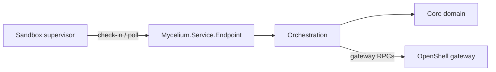

# Mycelium Service

This Component hosts the supervisor coordination surface and the
service-level operations that assemble Mycelium's pieces: the HTTP
check-in/poll endpoint that sandboxes talk to, agent sandbox provisioning,
and the reference supervisor that ships inside allowlisted images. Its own
application module is the running Mycelium service: it supervises the core
domain's Repo and the endpoint.

## Application contract

| Concern | Decision |
| --- | --- |
| Component kind | `library` profile (no product entrypoint) |
| Hex package name | `mycelium_service` |
| Module namespace | `Mycelium.Service` |
| Hex dependencies | `plug`, `bandit`, and `jason` only — endpoint stack; domain and orchestration come from capability requirements |
| Endpoint routes | `POST /mycelium/v1/checkin` and `POST /mycelium/v1/poll`, JSON bodies |
| Auth | optional bearer token; when configured, requests without it are refused |
| Reference supervisor | ships under `supervisor/` as the contract reference for image authors |

## Supervisor protocol surface

The endpoint implements the protocol owned by `mycelium-orchestration`:

- **check-in** — `POST /mycelium/v1/checkin` with body
  `{"sandbox": <gateway sandbox name>, "role": "serve", "connection": <id>,
  "address": <tailcat address>}`. The service resolves the sandbox row by
  gateway name and delegates to `register_check_in/4`. Success returns
  `{"ok": true}`; failures return a structured error body with an HTTP
  status.
- **poll** — `POST /mycelium/v1/poll` with body `{"sandbox": <gateway
  sandbox name>}`. The service resolves the sandbox row by gateway name and
  returns `{"assignments": [...]}` — the full desired state from
  `pending_assignments/1`.

### Requirement: Check-in delegates with validation, never trusts the payload

The endpoint SHALL refuse requests whose sandbox name does not resolve to a
bound domain sandbox row, whose body is not valid JSON, or whose bearer
token (when configured) does not match. Valid requests SHALL delegate to
the orchestration surface and map its results to HTTP responses: success
200, refused 404 (unknown sandbox) or 401 (auth), malformed 400. Errors
SHALL NOT echo credentials or gateway internals.

#### Scenario: Unknown sandbox name is refused

- **WHEN** a check-in names a sandbox that has no bound domain row
- **THEN** the response is 404 with a structured error and no domain
  mutation occurs

### Requirement: Poll returns the desired state as JSON

The poll endpoint SHALL return exactly the assignments computed by
`pending_assignments/1` for the resolved sandbox, encoded as JSON with
string keys. An unresolvable sandbox SHALL return 404.

#### Scenario: Poll shape matches the supervisor contract

- **WHEN** a supervisor polls a sandbox with one pending serve assignment
- **THEN** the response body is
  `{"assignments": [{"role": "serve", "connection": <id>}]}`

### Requirement: Agent sandbox provisioning is one operation

`provision_agent_sandbox/3` SHALL create the agent's domain sandbox row (via
the core context's sandbox creation function) and bind it to a real gateway
sandbox in one call, refusing agents that already have a bound row. It
SHALL NOT bypass the orchestration surface's allowlist and one-time-create
rules.

#### Scenario: Provisioning an agent is idempotent-refusing

- **WHEN** `provision_agent_sandbox/3` runs for an agent whose sandbox row
  is already bound
- **THEN** the call is refused with a structured error and no gateway
  sandbox is created

### Requirement: The reference supervisor implements the contract

The reference supervisor under `supervisor/` SHALL: poll on an interval,
start one `tailcat` listener per serve assignment and check in its address,
dial each dial assignment, tear down listeners and tunnels when their
assignments disappear, and exit non-zero when the endpoint is unreachable
for a sustained period. Port-level serving is a stated 0.1 limitation:
tunnels are stdio pipes; connection ports arrive with a later connection
extension.

#### Scenario: Supervisor reconciles a revoked connection

- **WHEN** a connection the supervisor is tunneling disappears from the poll
  response
- **THEN** the supervisor stops that tunnel and listener within one poll
  interval

## Non-goals for 0.1.0

User-facing APIs (project/user/agent management endpoints), approval
workflows UI, gateway sandbox stop/start/exec, connection ports, and
multi-replica deployments.
