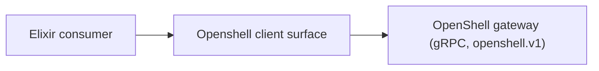

# OpenShell Elixir Client

This Component is the Elixir client SDK for the NVIDIA OpenShell gateway API. It
speaks the gateway's gRPC contract (`openshell.v1`) on behalf of consumers —
Mycelium's sandbox manager first, any other Elixir caller second — so that no
consumer needs to shell out to the `openshell` CLI or own protobuf tooling.

The OpenShell project ships SDKs for Go, Rust, Python, and TypeScript but not
Elixir. This Component fills that gap as a faithful client of the declared
gateway contract, vendored under `contract/proto/`.

## Application contract

| Concern | Decision |
| --- | --- |
| Component kind | `library` profile (no product entrypoint) |
| Hex package name | `openshell` |
| Module namespace | `Openshell` (public modules live inside it) |
| Wire contract | `openshell.v1` services from the vendored `contract/proto/` |
| Message modules | Pinned component assets under `contract/generated/` — protoc-generated `Openshell.V1`/`Openshell.Datamodel.V1`/`Openshell.Sandbox.V1`/`Openshell.Options.V1` modules; the client SHALL NOT hand-maintain message structs or encoders |
| Hex dependencies | `grpc` and `protobuf` only — the exact versions are pinned by the generated source BOM and frozen by the lifecycle |
| Error convention | `{:ok, term} \| {:error, %GRPC.RPCError{}}` |
| Transport | gRPC over HTTP/2 via the `grpc` package against the generated `Openshell.V1.OpenShell.Stub` (TLS by default, plaintext opt-in; mTLS client credentials via `:cert`/`:key` for gateways that require them) |
| Package links | homepage and source: `https://github.com/lesserevil/mycelium` |

The public module surface is defined by `interfaces/openshell-elixir.md`; consumers
SHALL depend on that interface rather than any generated file organization.

### Requirement: Mirror the declared gateway contract

The Component SHALL use the pinned protobuf asset modules under
`contract/generated/` (protoc-generated from the vendored `contract/proto/`
files) for every message and service stub, encoding and decoding through them.
It SHALL NOT hand-maintain parallel message structs, encoders, or decoders, and
SHALL NOT hand-write another copy of the service method table. The vendored
upstream commit pin (`contract/README.md`) is the contract identity; updating it
is an authored change to this Component that regenerates the assets.

#### Scenario: Gateway stubs come from the vendored contract

- **WHEN** the client calls any gateway RPC
- **THEN** the request and response messages are the pinned protobuf modules
  generated from the vendored `openshell.v1` contract, and a gateway that drifts
  from that contract fails the call with a structured gRPC status rather than a
  partially-valid exchange

### Requirement: The default transport performs real RPCs

The default transport SHALL open a gRPC channel over HTTP/2 with the `grpc`
package (TLS by default; plaintext when `tls: false`; mTLS client credentials
when `:cert`/`:key` are supplied) and SHALL dispatch every
public surface call to the corresponding `Openshell.V1.OpenShell.Stub` method.
No public surface call SHALL return a stubbed or simulated result; an
unreachable gateway SHALL surface as `{:error, %GRPC.RPCError{code: :unavailable}}`.

#### Scenario: Unary call against a live gateway

- **WHEN** `Health.check/2` runs against a reachable gateway
- **THEN** the response is decoded from the gateway's `HealthResponse` through
  the generated protobuf module and returned as `{:ok, :healthy}` or
  `{:ok, :degraded}`

### Requirement: Structured failures only

Every failing call SHALL return `{:error, %GRPC.RPCError{}}` carrying the canonical
gRPC status code; the Component SHALL NOT raise across the public surface for
expected remote failures and SHALL NOT return bare strings or ad-hoc error tuples.

#### Scenario: Unreachable gateway

- **WHEN** `connect/2` targets an address with no gateway listener
- **THEN** the caller receives `{:error, reason}` without a raised exception

### Requirement: Credentials stay out of logs and errors

The Component SHALL NOT include bearer tokens, sandbox JWTs, or other credentials
in exception messages, log output, or error payloads.

#### Scenario: Authenticated failure

- **WHEN** a call is rejected for bad credentials
- **THEN** the returned error identifies the status code and no token material
