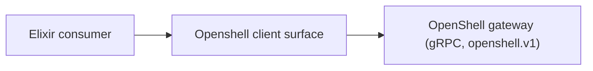

# OpenShell Elixir Client

This Component is the Elixir client SDK for the NVIDIA OpenShell gateway API. It
speaks the gateway's gRPC contract (`openshell.v1`) on behalf of consumers —
Mycelium's sandbox manager first, any other Elixir caller second — so that no
consumer needs to shell out to the `openshell` CLI or own protobuf tooling.

The OpenShell project ships SDKs for Go, Rust, Python, and TypeScript but not
Elixir. This Component fills that gap as a faithful client of the declared
gateway contract, vendored under `contract/proto/`.

## Application contract

| Concern | Decision |
| --- | --- |
| Component kind | `library` (no product entrypoint) |
| Hex package name | `openshell` |
| Module namespace | `Openshell` (public modules live inside it) |
| Wire contract | `openshell.v1` services from the vendored `contract/proto/` |
| Error convention | `{:ok, term} \| {:error, %GRPC.RPCError{}}` |
| Transport | gRPC over HTTP/2 (TLS by default, plaintext opt-in for local gateways) |

The public module surface is defined by `interfaces/openshell-elixir.md`; consumers
SHALL depend on that interface rather than any generated file organization.

### Requirement: Mirror the declared gateway contract

The Component SHALL derive every message and service stub from the vendored
`contract/proto/` files and SHALL NOT hand-maintain a parallel schema. The vendored
upstream commit pin (`contract/README.md`) is the contract identity; updating it is
an authored change to this Component.

#### Scenario: Gateway stubs come from the vendored contract

- **WHEN** the client calls any gateway RPC
- **THEN** the request and response messages are types generated from the vendored
  `openshell.v1` contract, and a gateway that drifts from that contract fails the
  call with a structured gRPC status rather than a partially-valid exchange

### Requirement: Structured failures only

Every failing call SHALL return `{:error, %GRPC.RPCError{}}` carrying the canonical
gRPC status code; the Component SHALL NOT raise across the public surface for
expected remote failures and SHALL NOT return bare strings or ad-hoc error tuples.

#### Scenario: Unreachable gateway

- **WHEN** `connect/2` targets an address with no gateway listener
- **THEN** the caller receives `{:error, reason}` without a raised exception

### Requirement: Credentials stay out of logs and errors

The Component SHALL NOT include bearer tokens, sandbox JWTs, or other credentials
in exception messages, log output, or error payloads.

#### Scenario: Authenticated failure

- **WHEN** a call is rejected for bad credentials
- **THEN** the returned error identifies the status code and no token material
